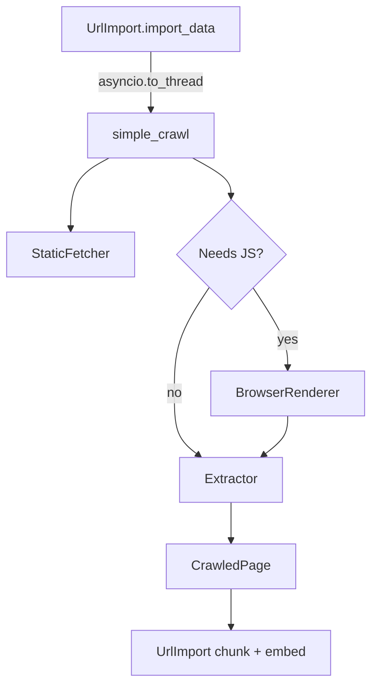

# URL Import — JS Rendering and Crawler Overhaul

Related: [project overview](../project-overview.md),
[build & deploy](../build-deploy.md).

## Spec

### Problem

URL import currently fetches raw HTML with `requests` and extracts text with
`trafilatura`. Client-side rendered (SPA/CSR) pages return only an empty JS
shell, producing empty or meaningless chunks. The crawler also lacks basic
quality protections.

Relevant files:

- `backend/app/models/url_import.py:62,178` calls `simple_crawler.simple_crawl`.
- `backend/app/internal/simple_crawler.py:9` implements the crawl loop.
- `backend/app/database.py:72` seeds the existing `CrawlDepth` setting.

Current gaps:

1. `requests.get()` with no browser headers, a 5 second timeout, no retries,
   and no content-type validation.
2. `trafilatura.extract(response.text)` runs on the raw HTML, so SPA/CSR pages
   yield an empty `<div id="root">` shell.
3. Links are discovered only from server-rendered `<a>` tags, so dynamic
   navigation is invisible.
4. No `robots.txt`, rate limiting, page cap, URL normalization, or content
   deduplication.
5. `simple_crawl()` is synchronous and is called directly from async
   `import_data` / `step_1` methods. Sync Playwright cannot run inside an
   active asyncio event loop.

### Goals

- Import client-side rendered pages by rendering with headless Chromium.
- Keep static pages fast: render only when needed (`auto` mode).
- Improve crawl quality: headers, retries, timeouts, robots, politeness,
  normalization, deduplication, page cap, titles.
- Preserve existing API/return contracts and cancellation behavior.
- Degrade gracefully when Playwright or its browser is unavailable.

### Non-goals

- Bypassing Cloudflare/anti-bot protections.
- Crawling authenticated areas or handling login flows.
- Replacing the existing chunker/embedding pipeline.
- Changing the frontend URL import flow beyond automatic settings rendering.
- Ingesting non-text resources. Images, video, audio, archives, and office
  documents are skipped. PDF links are accepted and their text is extracted.

### Decisions

| Decision | Choice |
|---|---|
| Rendering backend | Bundled Playwright Chromium |
| Render control | Auto-escalation + global settings |
| Scope | Full crawler quality overhaul |

Recorded as decision `D-01` in `../../decisions.md`.

### Architecture

Keep `simple_crawl()` as the public entry point and split internals by concern.

```
backend/app/internal/
  simple_crawler.py      # Orchestrator: queue, depth, limits, dedupe
  crawl_options.py       # CrawlOptions dataclass built from SettingsManager
  web_fetcher.py         # StaticFetcher (httpx) + render-decision logic
  browser_renderer.py    # Playwright sync renderer, browser reuse, cleanup
  url_utils.py           # Normalization, asset filtering, SSRF guard, robots
```



Result shape, extended for compatibility:

```python
{
    "url": str,        # displayed/normalized URL
    "text": str,       # extracted main content
    "title": str,      # <title> / og:title
    "final_url": str,  # after redirects
    "rendered": bool,  # whether the browser was used
}
```

## Plan

### 1. Static fetch layer (`web_fetcher.py`)

- Replace `requests` with `httpx.Client(http2=True, follow_redirects=True)`
  (httpx is already a dependency).
- Browser-like headers, including `User-Agent: RagatoolBot/0.2`, `Accept`,
  `Accept-Language`.
- Accept HTML/XHTML and PDF content types. PDF text is extracted with the
  existing `pypdf` stack. Other content types are rejected.
- Retry twice on timeout / 429 / 5xx with exponential backoff.
- Configurable timeout, default 20 seconds.

### 2. Render decision

`auto` mode renders when either condition is true:

- Extracted static text length `< MinStaticTextChars` (default 300), or
- HTML contains SPA markers (`id="root"`, `id="app"`, `__next`, `app-root`,
  `ng-version`, `data-reactroot`) and has multiple `<script>` tags.

`always` always renders. `off` never renders.

### 3. Browser renderer (`browser_renderer.py`)

- Lazy-import `playwright.sync_api`; if unavailable, log and fall back to
  static fetching.
- One Chromium launch and one context reused for the whole crawl, closed in a
  `finally` block.
- Launch args: `--no-sandbox`, `--disable-dev-shm-usage`.
- Per page:
  - `goto(url, wait_until="domcontentloaded", timeout=...)`.
  - Optional `wait_for_selector` when configured.
  - Short `networkidle` attempt, then `RenderWaitMs`.
  - Auto-scroll to trigger lazy-loaded content.
  - Extract `page.content()`; if still thin, use `page.inner_text("body")`.
  - Collect links from the rendered DOM.
- Block `image`, `media`, `font`, and analytics hosts to speed up rendering.
- A process-wide `threading.Semaphore` (`CRAWL_MAX_BROWSERS`, default 1)
  prevents multiple worker threads from launching multiple Chromiums.

### 4. Extractor

- Primary: `trafilatura.extract(html, url=url, include_tables=True,
  include_comments=False)`.
- Second pass with `favor_recall=True` when the primary result is short.
- Final fallback: BeautifulSoup text extraction after removing
  `script/style/nav/header/footer/aside`.
- Capture `<title>` and `og:title`.
- PDF responses are parsed with `pypdf`; all page text is concatenated and the
  PDF metadata title (or filename) is used. No links are followed from PDFs.

### 5. Crawl policy (`simple_crawler.py`, `url_utils.py`)

- Normalize URLs: lowercase scheme/host, drop fragment, sort query params,
  strip trailing slash; use normalized URL for `visited`.
- Skip non-http(s), `mailto:`, `javascript:`, and common asset extensions
  (`.jpg`, `.png`, `.css`, `.js`, `.zip`, etc.).
- Restrict to the same registrable domain unless `AllowSubdomains`.
- Enforce `MaxCrawlPages` (default 100).
- Enforce `CrawlRequestDelayMs` (default 300) between requests.
- Respect `robots.txt` via `urllib.robotparser`, cached per host.
- Deduplicate page content with SHA-256 of normalized text.
- Check the cancellation event between pages and during render loops.
- Optional progress callback so `UrlImport` can emit UI messages.
- Regex filter semantics: the pattern filters discovered links and redirect
  targets; the start URL is always imported even if it does not match.

### 6. Wiring (`url_import.py`)

- Build `CrawlOptions` from `context.settings`.
- Call the sync crawler in a worker thread:
  `await asyncio.to_thread(simple_crawler.simple_crawl, ...)`.
- Remove duplicate regex filtering (handled inside the crawler).
- Add page `title` to Chroma chunk metadata alongside `source`.
- Keep `None`-on-cancel behavior.

New crawler signature, preserving existing callers:

```python
def simple_crawl(
    start_url,
    cancel_event: Event,
    regex: Pattern[str] | None,
    max_depth: int = 1,
    options: CrawlOptions | None = None,
    on_progress=None,
) -> list[dict] | None:
    ...
```

### 7. Settings

Add enum members in `backend/app/schemas/setting.py` and seed rows in
`backend/app/database.py`. The Settings UI renders booleans as toggles and
numbers as numeric inputs. `JsRenderMode` is an explicit select with the
server-accepted values (`auto`, `always`, `off`); numeric inputs enforce the
backend minimums (`MaxCrawlPages`, `RequestTimeoutSec`, and `RetrievalFetchK`
are >= 1; wait/threshold/delay/depth settings allow 0).

| Setting | Default | Purpose |
|---|---|---|
| `JsRenderMode` | `auto` | `auto` / `always` / `off` |
| `RenderWaitMs` | `1500` | Wait after page load |
| `MinStaticTextChars` | `300` | Auto-render threshold |
| `MaxCrawlPages` | `100` | Total page cap |
| `RequestTimeoutSec` | `20` | HTTP/render timeout |
| `CrawlRequestDelayMs` | `300` | Politeness delay |
| `RespectRobotsTxt` | `True` | Honor robots.txt |
| `AllowSubdomains` | `False` | Crawl scope |

`CrawlDepth` remains unchanged.

### 8. Docker and dependencies

- `backend/pyproject.toml`: add `playwright>=1.49`.
- `backend/Dockerfile` runtime stage:

```dockerfile
ENV PLAYWRIGHT_BROWSERS_PATH=/ms-playwright
RUN /app/.venv/bin/python -m playwright install --with-deps chromium
```

- Expected image growth: roughly 300–400 MB.
- Local development: `uv sync && uv run playwright install chromium`.
- Env vars: `PLAYWRIGHT_BROWSERS_PATH`, `CRAWL_MAX_BROWSERS`,
  `ALLOW_PRIVATE_URLS`.

### 9. Security

A headless browser increases SSRF exposure. Guards are applied before every
outbound request, not after the fact:

- Reject `file:` and other unsupported schemes. The browser allows only
  `http(s)`/`ws(s)` plus local `data:`/`blob:`/`about:` resources.
- Resolve hostnames and reject private, loopback, link-local, reserved,
  multicast, and unspecified addresses.
- Static fetching disables automatic redirects and validates each hop before
  requesting it (`MAX_REDIRECTS = 5`).
- The renderer validates every request in its Playwright route handler, so
  redirects, XHR, scripts, and websockets are checked; results are cached per
  host for the duration of a crawl.
- `robots.txt` fetches go through the same host guard.
- Allow bypass with `ALLOW_PRIVATE_URLS=true` for trusted deployments.

Residual risk: DNS is resolved during the guard and again by the HTTP client /
browser, so a DNS-rebinding attacker retains a small TOCTOU window. This is an
accepted, documented best-effort limitation, not a complete network sandbox.
Playwright does not bypass anti-bot protections.

### 10. Tests

Unit tests:

- `test_simple_crawler.py`: static page does not render; thin SPA triggers
  rendering; `always`/`off` modes; normalization and duplicate suppression;
  asset skipping; `MaxCrawlPages`; robots disallow; content dedupe; title
  extraction; Playwright unavailable falls back to static.
- `test_url_import.py`: update assertions for the new `options=ANY` kwarg.
- `test_browser_renderer.py`: fake Playwright module; route-level SSRF checks;
  bounded auto-scroll.
- `test_browser_renderer_integration.py`: launches real Chromium against a
  local HTTP server; skipped unless `CRAWL_INTEGRATION=1`. The
  `browser-integration` CI job installs Chromium and runs it.
- `test_web_fetcher.py`: manual redirect handling, private redirect rejection,
  PDF/HTML classification.

Manual verification:

1. `cd backend && uv sync && uv run playwright install chromium`.
2. `CRAWL_INTEGRATION=1 uv run pytest tests/test_browser_renderer_integration.py`.
3. Import a known CSR page with `CrawlDepth=0`; confirm non-empty chunks and
   rendered pages.
4. `docker compose build backend` to validate browser installation.

### 11. Implementation checklist

- [x] Add `CrawlOptions`, `url_utils`, and settings enum/seed rows.
- [x] Implement `StaticFetcher`, extraction fallback, and render decision.
- [x] Implement `BrowserRenderer` with reuse, resource blocking, cleanup.
- [x] Refactor `simple_crawl` for normalization, limits, robots, dedupe,
      titles, and progress callback.
- [x] Wire `UrlImport` via `asyncio.to_thread`; add title metadata.
- [x] Add Playwright dependency and Docker browser installation.
- [x] Add SSRF guard and document env vars/limitations.
- [x] Update and add tests; run backend test suite.
- [x] Add opt-in real-Chromium integration test and CI job.
- [ ] Manual CSR import verification and Docker build verification.

### Risks and tradeoffs

- Image size and RAM increase; mitigated by `CRAWL_MAX_BROWSERS=1`.
- Rendering is slower; static pages remain fast because rendering escalates
  only when needed.
- Some bot-protected sites remain blocked.
- `asyncio.to_thread` cannot hard-interrupt a stuck browser call; bounded by
  `RequestTimeoutSec`.
- Auto-detection is heuristic and may over- or under-render edge cases.

### Open questions

- ~~Should PDF URLs discovered during a crawl be downloaded and parsed, or
  skipped?~~ Decided: download and parse PDF text; other files/media are still
  skipped.
- Should per-import overrides (render mode) be exposed in the URL dialog later?
- Is `MaxCrawlPages=100` a suitable default for local deployments?

## Outcome

Implemented on `feature/url-import-js-rendering`. Backend suite passes
(170 passed, 1 skipped: the opt-in Chromium integration test). The crawler
imports HTML text pages and extracts text from PDF links with `pypdf`; other
non-text content types and asset/file extensions (images, audio, video,
archives, office documents, EPUB) are skipped.

Follow-up review fixes: dead code removed (`crawl_from_list`, unused
`max_browsers` option); SSRF guard now validates every redirect hop and browser
subresource before the request; robots.txt fetches are guarded; cancellation
now unlocks the collection; regex redirect escapes are closed; PDF vs HTML
classification is explicit; auto-scroll is bounded and cancellable; the
settings UI accepts zero-valued numeric settings; the Docker browser layer is
cached before source copy. Manual CSR import and Docker image build
verification remain pending.
